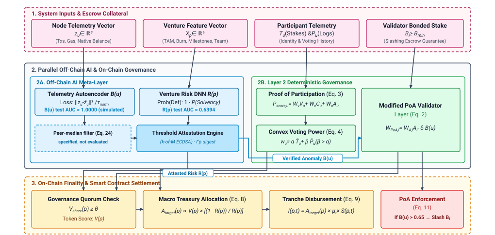

# AIPoX: A Hybrid Consensus and Governance Protocol for Secure and Meritocratic Capital Allocation in Venture DAOs

[](https://soliditylang.org/)
[](https://www.python.org/)
[](https://trufflesuite.com/ganache/)
[](https://opensource.org/licenses/MIT)

Official research repository for **AIPoX** (*Artificial Intelligence Proof of X*). It contains the Solidity contracts, the off-chain machine-learning pipeline, the simulated benchmark data, the on-chain verification scripts and the results reported in the manuscript.

> **Scope.** AIPoX is evaluated in a controlled simulation. The venture cohort is synthetic, the telemetry is simulated, and the on-chain experiments run on a single-node Ganache EVM. The repository does not evaluate distributed validator agreement, finality or Byzantine network behavior.

---

## Table of Contents

- [1. Overview](#1-overview)
- [2. Architecture](#2-architecture)
- [3. Core Formulations](#3-core-formulations)
- [4. Repository Structure](#4-repository-structure)
- [5. Data](#5-data)
- [6. Reproduction](#6-reproduction)
- [7. Results Summary](#7-results-summary)
- [8. Citation](#8-citation)

---

## 1. Overview

AIPoX combines four layers to address plutocratic token concentration, weak venture due diligence and single-oracle manipulation in venture DAOs.

1. **Consensus substrate.** A Proof-of-Authority (PoA) validator set. Validators post a bond $B_i$ in escrow, and the bond is slashed when a validator's behavior score crosses a threshold.
2. **Meritocratic governance.** The voting weight combines normalized token stake $\bar{T}_u$ with normalized participation $\bar{P}_u$, so capital volume alone does not determine the outcome.
3. **Off-chain AI meta-layer.** An autoencoder $B(u)$ scores telemetry anomalies. A neural network $R(p)$ estimates the default risk of a venture proposal.
4. **Attestation and settlement.** A $k$-of-$M$ ECDSA committee signs a digest that binds the proposal, the risk score and the approved model hash. A risk-odds rule then allocates the treasury.

---

## 2. Architecture

### Figure 1 | End-to-end operational architecture

<p align="center">
  
</p>

### Figure 3 | Dual-stream AI layer and inference pipeline

<p align="center">
  
</p>

### Figure 4 | Governance workflow

<p align="center">
  
</p>

---

## 3. Core Formulations

Equation numbers follow the manuscript.

### 3.1 Validator selection (Eq. 1)

$$
P_{\text{PoA}}(i) = \frac{B_i}{\sum_{j=1}^{n} B_j} \qquad \text{subject to } B_i \ge B_{\min}
$$

### 3.2 Participation and normalization (Eq. 2)

$$
\bar{T}_u = \frac{T_{u}}{\sum_{k \in \mathcal{U}} T_{k}}, \qquad \bar{P}_u = \frac{P_{u}}{\sum_{k \in \mathcal{U}} P_{k}}, \qquad \sum_{u \in \mathcal{U}} \bar{T}_u = \sum_{u \in \mathcal{U}} \bar{P}_u = 1
$$

### 3.3 Composite voting weight (Eq. 3)

$$
w_u = \alpha \, \bar{T}_u + \beta \, \bar{P}_u, \qquad \alpha = 0.4, \quad \beta = 0.6
$$

### 3.4 Proposal score (Eq. 4)

$$
V(p) = \alpha \sum_{u \in \mathcal{V}_p} T_{u} + \beta \, T_{\text{active}} \sum_{u \in \mathcal{V}_p} \bar{P}_u
$$

### 3.5 Telemetry anomaly score (Eq. 5)

$$
B(u) = \min\left(1, \tfrac{1}{8}\lVert z_u - \hat{z}_u \rVert^2\right), \qquad z_u \in \mathbb{R}^8
$$

### 3.6 Venture risk network (Eqs. 6–8)

$$
h_1 = \mathrm{ReLU}(W_1 X_p + b_1), \qquad h_2 = \mathrm{ReLU}(W_2 \, \mathrm{Dropout}(h_1) + b_2), \qquad R(p) = \sigma(W_3 h_2 + b_3)
$$

with $X_p \in \mathbb{R}^6$ and architecture $6 \to 32 \to 16 \to 1$.

### 3.7 Attestation digest (Eq. 9)

$$
\Gamma_p = \text{Keccak-256}\big(\text{contract} \parallel \text{chainId} \parallel pid \parallel \text{epoch} \parallel \text{nonce} \parallel \text{ModelHash} \parallel \text{riskScaled}\big)
$$

### 3.8 Freshness (Eq. 10)

$$
\text{BlockNumber}_{\text{current}} - \text{BlockNumber}_{\text{attested}} \le \Delta_{\text{validity}}
$$

### 3.9 Ejection and slashing (Eqs. 11–12)

Ejection occurs when

$$
10000 \cdot B(u) \ge 4359 \qquad (\tau = 0.435854)
$$

Slashing is applied only when $B(u) \ge \tau$:

$$
B_i^{\text{new}} = (1 - B(u)) \cdot B_i^{\text{old}}
$$

### 3.10 Treasury allocation (Eqs. 13–15)

$$
W(p) = V(p)\,\frac{1 - R(p)}{R(p)}, \qquad A(p) = \min\left(\Omega_{\max}\, T_{\text{pool}},\; \lambda^{*} \, W(p)\right), \qquad \sum_{p} A(p) = T_{\text{pool}}
$$

### 3.11 Milestone tranches (Eq. 16)

$$
I(p, t) = A(p) \cdot \mu_t \cdot S(p, t), \qquad S(p, t) \in [0, 1]
$$

The milestone oracle $S(p, t)$ is specified but not evaluated in this work.

### 3.12 Plutocratic resistance (Proposition 1, Eqs. 17–18)

Under unanimous community voting, the community outvotes a whale with capital share $c$ if

$$
\beta > \beta^{*}(c) = \frac{2c - 1}{(2c - 1) + (\bar{P}_c - \bar{P}_w)}
$$

For $k = 1$ and $P = 0.28$, $\beta^{*}(0.6) = 0.167$.

---

## 4. Repository Structure

```text
DAO-VC-AIPoX/
├── 1_deploy_and_run_onchain.py      # Deploys contracts, runs the on-chain test suite, votes, attestations, allocation
├── 2_generate_verified_tables.py    # Builds Tables 3, 4, 5, 6, 7, 7b, 7c, 8, 8b from on-chain logs
├── 3_plot_publication_figures.py    # Builds Figures 5, 6 and 7
├── run_pipeline.py                  # Runs the full pipeline in order
├── Contracts/
│   ├── InvestmentSmartContract.sol  # Voting, attestation, risk-odds allocation, milestone tranches
│   └── PoAValidatorEscrow.sol       # Validator bonds, unbonding, attested slashing
├── Data/
│   ├── 3_train_models.py            # Trains R(p) and B(u) (protocol v2, seed 42)
│   ├── fig2_roc.py                  # Builds Figure 2 from the saved models; refuses to write if metrics differ from train_report.json
│   ├── 06_score_proposals.py        # Selects P-1 ... P-5 from the held-out test split
│   ├── cohorts/
│   │   └── venture_cohort_primary.csv   # Synthetic venture cohort with split column
│   ├── user_behavior_clean.csv      # Cleaned simulated telemetry (600,000 rows)
│   ├── big_startup_secsees_dataset.csv  # Crunchbase venture records (66,368 raw)
│   └── models/
│       ├── venture_risk_dnn.pt      # R(p) weights
│       ├── telemetry_autoencoder.pt # B(u) weights
│       ├── scalers.joblib           # Feature scalers and protocol metadata
│       ├── threshold.json           # tau and threshold_bps
│       ├── model_hash.json          # ModelHash committed on-chain
│       └── train_report.json        # Training and test metrics
├── figures/
│   ├── Figure_1_Operational_Architecture.svg
│   ├── Figure_2_ROC_AI_Meta_Layer.png
│   ├── Figure_3_AI_Layer.svg
│   ├── Figure_4_Governance_Workflow.svg
│   ├── Figure_5_Treasury_Reallocation.png
│   ├── Figure_6_Ablation_Decomposition.png
│   └── Figure_7_Whale_Fragmentation.png
└── Results.md                       # Full result tables and on-chain logs
```

---

## 5. Data

| Dataset | Records | Use | Notes |
| :--- | ---: | :--- | :--- |
| Crunchbase venture records (`big_startup_secsees_dataset.csv`) | 66,368 raw; 13,332 cleaned | Calibration checks only | Real records. They are not used as labels for $R(p)$. |
| Synthetic venture cohort (`cohorts/venture_cohort_primary.csv`) | Test split $n = 1{,}797$ | Training and evaluation of $R(p)$ | Generated by the procedure in the manuscript. Not empirical venture outcomes. |
| Simulated telemetry (`user_behavior_clean.csv`) | 600,000 (test $n = 90{,}000$, 5% bots) | Training and evaluation of $B(u)$ | Simulated. Features: transaction count, balance, gas, latency, entropy, packet drop, clustering, uptime. |

Splits are 70/15/15 with seed 42. The honest validation rows set the threshold $\tau$.

---

## 6. Reproduction

### Prerequisites

- Python 3.10 or later
- Ganache running at `http://172.16.22.120:8545` or `http://127.0.0.1:8545`
- `solc` 0.8.19 (installed automatically by `py-solc-x`)

### Installation

```bash
git clone <REPOSITORY_URL>
cd DAO-VC-AIPoX
pip install web3 py-solc-x pandas numpy matplotlib scikit-learn joblib eth-account torch
```

### Full pipeline

```bash
python run_pipeline.py
```

### Step by step

```bash
# 1. Train the off-chain models (writes Data/models/)
cd Data
python 3_train_models.py

# 2. Build Figure 2 from the saved models (checks metrics against train_report.json)
python fig2_roc.py

# 3. Select and score the five proposals
python 06_score_proposals.py
cd ..

# 4. Deploy the contracts and run the on-chain suite
python 1_deploy_and_run_onchain.py

# 5. Build the verified tables from the on-chain outputs
python 2_generate_verified_tables.py

# 6. Build Figures 5, 6 and 7
python 3_plot_publication_figures.py
```

Step 2 stops with an error if the recomputed AUC, sample sizes, TPR or FPR differ from `train_report.json` by more than $5 \times 10^{-5}$.

---

## 7. Results Summary

All numbers come from the final pipeline run. The complete tables and on-chain logs are in [`Results.md`](Results.md).

### AI meta-layer (held-out test set)

| Model | Input | Test $n$ | ROC-AUC | Notes |
| :--- | :---: | ---: | :---: | :--- |
| Telemetry autoencoder $B(u)$ | $z_u \in \mathbb{R}^8$ | 90,000 | **1.0000** | Simulated bot traffic. TPR at $\tau$ = 100%, FPR = 1.04% |
| Venture risk DNN $R(p)$ | $X_p \in \mathbb{R}^6$ | 1,797 | **0.6394** | 95% CI [0.6145, 0.6642]. Brier = 0.2294 (baseline 0.2347) |

### Treasury allocation ($1,000,000 pool)

| Proposal | $R(p)$ | dPoS (USD) | AIPoX (USD) | Change |
| :---: | :---: | ---: | ---: | :---: |
| P-1 | 0.371357 | 185,913.06 | 359,604.95 | +93.43% |
| P-2 | 0.482516 | 258,366.77 | 250,084.95 | −3.21% |
| P-3 | 0.541779 | 216,930.25 | 183,625.88 | −15.35% |
| P-4 | 0.599348 | 193,910.71 | 124,268.00 | −35.91% |
| P-5 | 0.657715 | 144,879.21 | 82,416.21 | −43.11% |

### Attacks

| Attack | Target | Effect on target allocation |
| :--- | :---: | :--- |
| Sybil: 1,500 identities, 1,500,000 tokens | P-5 | +28.59% (rank 1 under dPoS; rank 5 under AIPoX) |
| Whale: 60% of supply, $P = 0.28$ | P-5 | +159.55% |
| Whale: 60% of supply, $P = 0.98$ | P-5 | +160.14% |
| Whale fragmented over 1,000 identities, $P = 0.98$ | P-5 | +385.34% (cap binding; P-5 becomes top proposal) |

### On-chain test suite

- 66 checks: 54 passed, 0 failed, 12 expected reverts (rejected as designed).
- Expected reverts cover stale nonces, non-committee signers, repeated votes per epoch, votes after finalisation, out-of-sequence tranches and tranches exceeding the budget.

---

## 8. Citation

If you use this code, these datasets or the formulations, please cite the paper:

```bibtex
@article{shahmohammadi2026aipox,
  title={AIPoX: A hybrid consensus protocol for secure and meritocratic governance in venture capital DAOs},
  author={Shahmohammadi, Erfan and Elmi Sola, Yasser and Neghabi, Ali Akbar and Hasanpour, Hessam},
  journal={Scientific Reports},
  year={2026},
  publisher={Nature Portfolio}
}
```

For questions about reproduction or the smart contracts, please open an issue on this repository.
