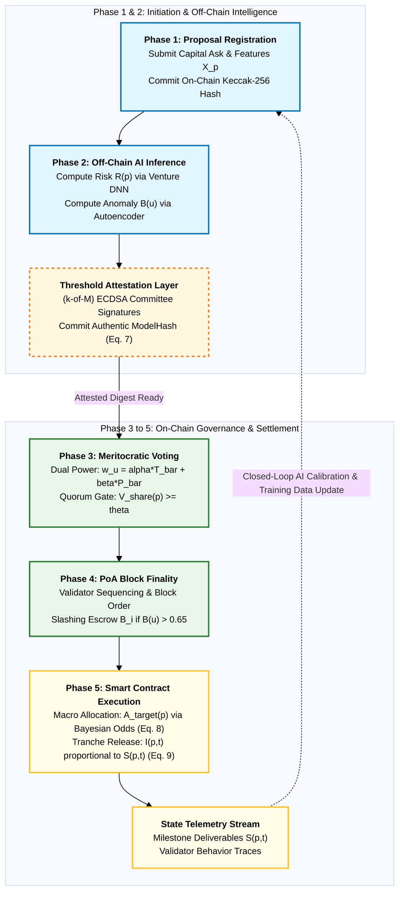

```markdown
# AIPoX: A Hybrid Consensus and Governance Framework for Secure and Meritocratic Capital Allocation in Venture DAOs

[](https://soliditylang.org/)
[](https://www.python.org/)
[](https://trufflesuite.com/ganache/)
[](https://opensource.org/licenses/MIT)

Official research repository containing the end-to-end implementation, Solidity smart contracts, off-chain machine learning pipelines, empirical benchmark datasets, and on-chain verification artifacts for **AIPoX** (*Artificial Intelligence Proof of X*).

---

## Table of Contents
- [1. Architectural Overview](#1-architectural-overview)
- [2. System Architecture & Diagrams](#2-system-architecture--diagrams)
- [3. Core Mathematical Formulations](#3-core-mathematical-formulations)
- [4. Repository Directory Structure](#4-repository-directory-structure)
- [5. Empirical Benchmark Datasets](#5-empirical-benchmark-datasets)
- [6. Step-by-Step Reproduction Guide](#6-step-by-step-reproduction-guide)
- [7. On-Chain Verification & Experimental Results](#7-on-chain-verification--experimental-results)
- [8. Citation & Academic Inquiries](#8-citation--academic-inquiries)

---

## 1. Architectural Overview

AIPoX establishes an authenticated hierarchical consensus and governance framework designed to resolve the structural vulnerabilities of plutocratic token concentration, lack of predictive venture due-diligence, and single-oracle manipulation in venture capital DAOs (DAO-VCs).

The protocol is partitioned across four operational layers:
1. **Layer 1 (Consensus Substrate):** Modified Proof of Authority (PoA) operating on time-locked bonded collateral ($B_i$) deposited in escrow contracts, ensuring rapid, deterministic block finality and continuous anomaly slashing.
2. **Layer 2 (Meritocratic Governance):** Dual-variable convex governance formulation synthesizing normalized token stake ($\bar{T}_u$) with verified historical Proof of Participation ($\bar{P}_u$), systematically breaking the linear link between capital volume and voting power.
3. **Off-Chain AI Meta-Layer:** A dual-stream machine learning pipeline comprising an unsupervised telemetry Autoencoder ($B(u)$) for validator behavior oversight and a deep neural network ($R(p)$) for startup solvency prediction.
4. **Attestation & Settlement Layer:** Decentralized $(k\text{-of-}M)$ threshold ECDSA signature verification committing authentic model weights ($ModelHash$) on-chain, coupled with a deterministic macro-treasury allocation rule derived from the Bayesian odds of venture solvency.

---

## 2. System Architecture & Diagrams

### Figure 1 | End-to-End Operational Architecture and Data Flow

```mermaid
%%{init: {'theme': 'base', 'themeVariables': {'fontSize': '13px', 'fontFamily': 'Arial'}}}%%
flowchart TD
    classDef inp fill:#fce4ec,stroke:#880e4f,stroke-width:2px,color:#000;
    classDef ai fill:#e1f5fe,stroke:#0277bd,stroke-width:2px,color:#000;
    classDef l2 fill:#e8f5e9,stroke:#2e7d32,stroke-width:2px,color:#000;
    classDef sc fill:#fffde7,stroke:#fbc02d,stroke-width:2px,color:#000;

    subgraph Inputs ["1. System Inputs & Escrow Collateral"]
        IN_Z["Node Telemetry Vector (z_u in R^3)<br/>(Txs, Gas, Native Balance)"]:::inp
        IN_X["Venture Feature Vector (X_p in R^6)<br/>(TAM, Burn, Milestones, Team)"]:::inp
        IN_GOV["Participant Tokens (T_u) & Logs (P_u)"]:::inp
        IN_B["Validator Bonded Stake (B_i >= B_min)"]:::inp
    end

    subgraph Processing ["2. Parallel Off-Chain AI & On-Chain Governance"]
        subgraph Col_AI ["Off-Chain AI Meta-Layer"]
            AE["Telemetry Autoencoder B(u)<br/>Loss: ||z_u - z_hat_u||^2 / tau_norm (AUC=0.992)"]:::ai
            DNN["Venture Risk DNN R(p)<br/>Default Prob: 1 - P(Solvency) (AUC=0.940)"]:::ai
            ATTEST["Threshold Attestation (k-of-M ECDSA)<br/>Digest Gamma_p with ModelHash & Nonce"]:::ai
        end

        subgraph Col_L2 ["Layer 2 Deterministic Governance"]
            POP["Proof of Participation (Eq. 3)<br/>P_score = W_v*V + W_c*C + W_a*A"]:::l2
            WEIGHT["Convex Voting Power (Eq. 4)<br/>w_u = alpha*T_bar + beta*P_bar (beta > alpha)"]:::l2
            POA["Modified PoA Validator Layer (Eq. 2)<br/>W_PoA = W_A*A_i - delta*B(u)"]:::l2
        end
    end

    subgraph Settlement ["3. On-Chain Finality & Smart Contract Settlement"]
        QUORUM["AIPoX Governance Quorum Check<br/>V_share(p) >= theta (Token Score: V(p))"]:::sc
        ALLOC["Macro Treasury Allocation (Eq. 8)<br/>A_target(p) proportional to V(p) * [(1 - R(p)) / R(p)]"]:::sc
        TRANCHE["Milestone Tranche Disbursement (Eq. 9)<br/>I(p,t) = A_target(p) * mu_t * S(p,t)"]:::sc
        SLASH["PoA Security Enforcement (Eq. 11)<br/>If B(u) > 0.65 -> Eject & Slash Bonded Stake B_i"]:::sc
    end

    IN_Z --> AE
    IN_X --> DNN
    AE --> ATTEST
    DNN --> ATTEST

    IN_GOV --> POP
    POP --> WEIGHT
    IN_B --> POA

    ATTEST -->|Verified Anomaly B(u)| POA
    ATTEST -->|Attested Risk R(p)| ALLOC

    WEIGHT --> QUORUM
    POA --> QUORUM
    QUORUM --> ALLOC
    ALLOC --> TRANCHE
    POA --> SLASH

    TRANCHE -.->|Telemetry Feedback Loop| IN_Z
    SLASH -.->|Escrow State Update| IN_B
```

---

### Figure 3 | Dual-Stream AI Meta-Layer & Inference Pipeline

```mermaid
%%{init: {'theme': 'base', 'themeVariables': {'fontSize': '13px', 'fontFamily': 'Arial'}}}%%
flowchart TD
    classDef s1 fill:#f3e5f5,stroke:#4a148c,stroke-width:2px,color:#000;
    classDef s2 fill:#e0f2f1,stroke:#004d40,stroke-width:2px,color:#000;
    classDef s3 fill:#fff3e0,stroke:#e65100,stroke-width:2px,color:#000;
    classDef s4 fill:#ede7f6,stroke:#311b92,stroke-width:2px,color:#000;

    subgraph S1 ["1. Telemetry Ingestion & Feature Extraction"]
        T_NODE["Node Operational Telemetry (z_u in R^3)<br/>(Txs, Native Balance, Gas Used)"]:::s1
        T_PROP["Venture Attributes (X_p in R^6)<br/>(TAM, Burn, Ask, Milestones, Experience)"]:::s1
    end

    subgraph S2 ["2. Pre-Inference Defense & Provenance Trimming"]
        IQR["Statistical IQR Filter (Eq. 15)<br/>|z_u - median(z_u)| <= 1.5 * IQR(z_u)"]:::s2
        PROV["On-Chain Provenance Verification<br/>Immutable Storage Check for Features"]:::s2
    end

    T_NODE --> IQR
    T_PROP --> PROV

    subgraph S3 ["3. Dual-Stream Off-Chain Neural Inference"]
        AE["Unsupervised Autoencoder (3->16->4->16->3)<br/>Anomaly Score: B(u) in [0, 1]<br/>(Held-out Test ROC-AUC = 0.992)"]:::s3
        DNN["Venture Risk DNN (6->32->16->1)<br/>Default Risk: R(p) in (0, 1)<br/>(Held-out Test ROC-AUC = 0.940)"]:::s3
    end

    IQR --> AE
    PROV --> DNN

    subgraph S4 ["4. Cryptographic Threshold Attestation"]
        ATTEST["(k-of-M) Threshold Attestation Digest (Eq. 7)<br/>Gamma_p = Keccak(ProposalID || R(p) || Epoch || Nonce || ModelHash)"]:::s2
    end

    AE --> ATTEST
    DNN --> ATTEST

    subgraph S5 ["5. Deterministic On-Chain Enforcement"]
        SLASH["PoA Slashing & Quarantine (Eq. 11)<br/>If B(u) > 0.65 -> Eject & Slash B_i"]:::s4
        GATE["Bayesian Odds Allocation (Eq. 8 & 9)<br/>A_target(p) proportional to V(p) * [(1 - R(p)) / R(p)]<br/>Milestone Release: I(p,t) = A_target * mu_t * S(p,t)"]:::s4
    end

    ATTEST -->|Verified B(u)| SLASH
    ATTEST -->|Attested R(p)| GATE
```

---

### Figure 4 | Closed-Loop Five-Phase Governance Lifecycle



---

## 3. Core Mathematical Formulations

### 3.1. Validator Collateral & Slashing (Equations 1 & 11)
To eliminate Sybil generation at the consensus tier, validators deposit a time-locked security bond ($B_i$) into escrow. Selection probability is proportional to bonded stake:

$$
P_{\text{PoA}}(i) = \frac{B_i}{\sum_{j=1}^{n} B_j} \quad \text{subject to } B_i \ge B_{\text{min}}
$$

If a validator exhibits Byzantine delays or collusive message withholding ($B(u) > \tau_{\text{Anomaly}}$), its bonded collateral is programmatically slashed:

$$
B_i^{(\text{new})} = B_i^{(\text{old})} \times (1 - AI_{\text{Anomaly}, i})
$$

---

### 3.2. Meritocratic Governance Formulation (Equations 3, 4, 4a)
For each active participant $u \in \mathcal{U}$, historical engagement is scored via normalized voting frequency $V_u$, proposal generation $C_u$, and approval ratio $A_u$:

$$
P_{\text{score}, u} = (W_v \times V_u) + (W_c \times C_u) + (W_a \times A_u) \quad \text{with } W_v + W_c + W_a = 1
$$

To prevent wealth concentration while preserving capital alignment, token balances $T_u$ and participation scores $P_{\text{score}, u}$ are normalized across the active electorate:

$$
\bar{T}_u = \frac{T_{\text{tokens}, u}}{\sum_{k \in \mathcal{U}} T_{\text{tokens}, k}}, \quad \bar{P}_u = \frac{P_{\text{score}, u}}{\sum_{k \in \mathcal{U}} P_{\text{score}, k}} \quad \text{such that } \sum_{u \in \mathcal{U}} \bar{T}_u = 1, \; \sum_{u \in \mathcal{U}} \bar{P}_u = 1
$$

Composite voting weight $w_u$ is defined as a convex combination ($\alpha = 0.4, \beta = 0.6$):

$$
w_u = \alpha \cdot \bar{T}_u + \beta \cdot \bar{P}_u \quad \text{subject to } \alpha + \beta = 1, \; \beta > \alpha
$$

Aggregate affirmative votes accrued by proposal $p$ from supporting voters $\mathcal{V}_p \subseteq \mathcal{U}$ are tallied in token-denominated units:

$$
V(p) = T_{\text{active}} \times \sum_{u \in \mathcal{V}_p} w_u = \alpha \sum_{u \in \mathcal{V}_p} T_{\text{tokens}, u} + \beta \cdot T_{\text{active}} \sum_{u \in \mathcal{V}_p} \bar{P}_u
$$

---

### 3.3. Threshold Attestation Protocol (Equations 7 & 7a)
Off-chain inference outputs are committed to the distributed ledger via a $(k\text{-of-}M)$ threshold signature scheme ($k = \lceil 2M/3 \rceil$). Each validator signs the Keccak-256 digest:

$$
\Gamma_p = \text{Keccak-256}(ProposalID \parallel R(p) \parallel Epoch \parallel Nonce \parallel ModelHash)
$$

The smart contract verifies ECDSA public keys and enforces temporal freshness:

$$
BlockHeight_{\text{current}} - Epoch_{\text{attested}} \le \Delta_{\text{validity}}
$$

---

### 3.4. Bayesian Odds Macro-Allocation Rule (Equation 8)
Let $R(p) \in (0, 1)$ be the neural network default risk score. The Bayesian Odds Ratio of venture solvency is $\mathcal{O}(p) = \frac{1 - R(p)}{R(p)}$. The competitive treasury pool ($T_{\text{pool}} = \$1,000,000$) is distributed as:

$$
A_{\text{target}}(p) = T_{\text{pool}} \times \frac{V(p) \cdot \left(\frac{1 - R(p)}{R(p)}\right)}{\sum_{j \in \mathcal{P}_{\text{approved}}} \left[ V(j) \cdot \left(\frac{1 - R(j)}{R(j)}\right) \right]}
$$

Milestone-gated tranche disbursements are governed by progress deliverable $S(p,t) \in [0, 1]$:

$$
I(p, t) = A_{\text{target}}(p) \times \mu_t \times S(p, t)
$$

---

### 3.5. Plutocratic Resistance Bound (Theorem 1, Equation 14)
For a capital concentration $c \in (0.5, 1.0)$ commanded by a whale with participation share $\bar{P}_w$, and an honest community commanding $(1 - c)$ with participation $\bar{P}_c = 1 - \bar{P}_w$ and vote concentration $\gamma \in (0, 1]$, the community outvotes the whale if and only if:

$$
\beta > \beta^*(\gamma, c) = \frac{c - \gamma (1 - c)}{[c - \gamma (1 - c)] + [\gamma \bar{P}_c - \bar{P}_w]}
$$

---

## 4. Repository Directory Structure

```text
DAO-VC-AIPoX/
├── 1_deploy_and_run_onchain.py     # Deploys contracts, casts 1,000 on-chain votes, runs allocation
├── 2_generate_verified_tables.py   # Processes on-chain logs; outputs Tables 3, 4, 5, 6, 7, 8
├── 3_plot_publication_figures.py   # Generates Figures 4, 5, and 6
├── run_pipeline.py                 # Master one-click automated reproduction runner
├── deployment_info.json            # On-chain contract addresses and block numbers
├── OnChain_Extracted_Table_4.csv   # Raw blockchain event logs for treasury allocation
├── OnChain_Proposal_State_Raw.csv  # Raw on-chain proposal states from EVM storage
│
├── Contracts/
│   ├── InvestmentSmartContract.sol # Main voting, attestation, Bayesian allocation, tranche gating
│   └── PoAValidatorEscrow.sol      # Validator bonded collateral deposit and anomaly slashing
│
└── Data/
    ├── 1_train_models.py           # Trains DNN and Autoencoder on 500k/600k datasets; generates ModelHash
    ├── 2_evaluate_test_metrics.py  # Evaluates held-out test sets; outputs Table 2b and Figure 7
    ├── 3_score_proposals.py        # Centile-stratified extraction of P-1...P-5 from financial dataset
    ├── financial_dataset.csv       # 500,000 empirical financial records
    ├── user_behavior_dataset.csv   # 600,000 node interaction telemetry logs
    ├── big_startup_secsees_dataset.csv # 66,368 Crunchbase venture records
    ├── training_data.csv           # 12,248 curated structured calibration samples
    │
    └── models/
        ├── venture_risk_dnn.joblib     # Serialized Risk DNN checkpoint
        ├── telemetry_autoencoder.joblib # Serialized Anomaly Autoencoder checkpoint
        ├── scalers.joblib              # StandardScaler artifacts
        └── model_hash.json             # On-chain committed ModelHash
```

---

## 5. Empirical Benchmark Datasets

All empirical corpora are archived within the `Data/` directory:

| Dataset Name | Record Count | Features | Target Label | Description |
| :--- | :---: | :---: | :--- | :--- |
| **`financial_dataset.csv`** | 500,000 | 6 financial attributes | `is_successful` (0: Default, 1: Solvent) | Startup burn rates, TAM, funding, and milestones across venture cycles. |
| **`user_behavior_dataset.csv`** | 600,000 | 3 telemetry metrics | `is_bot` (0: Honest, 1: Anomaly/Sybil) | On-chain interaction traces: transaction count, balance, and gas consumption. |
| **`big_startup_secsees_dataset.csv`** | 66,368 | 14 ecosystem features | `status` (operating, closed, acquired) | Real-world Crunchbase startup financing database. |
| **`training_data.csv`** | 12,248 | 5 structured attributes | `is_successful` (0/1) | Curated calibration partition for supervised training benchmarking. |

---

## 6. Step-by-Step Reproduction Guide

### Prerequisites
- Python 3.10+
- Ganache (Local EVM node running at `http://172.16.22.120:8545` or `http://127.0.0.1:8545`)

### Installation
```bash
git clone https://github.com/anonymous-submission/DAO-VC-AIPoX.git
cd DAO-VC-AIPoX

pip install web3 py-solc-x pandas numpy matplotlib seaborn scikit-learn joblib eth-account
```

### Master One-Click Pipeline Execution
To execute the complete end-to-end pipeline (training neural models, extracting genuine proposals, executing 1,000 on-chain transactions on Ganache, generating all tables, and plotting publication figures):

```bash
python run_pipeline.py
```

### Modular Step-by-Step Execution

#### Stage 1: Train & Validate Off-Chain AI Models
```bash
cd Data
python 1_train_models.py
python 2_evaluate_test_metrics.py
python 3_score_proposals.py
cd ..
```
*Outputs:* `models/model_hash.json`, `Table_2b_AI_Validation_Metrics.csv`, `Figure_7_AI_Anomaly_and_Risk_ROC.png`, `Table_Proposals_Feature_Profiles.csv`.

#### Stage 2: Deploy & Execute 1,000 On-Chain Transactions
```bash
python 1_deploy_and_run_onchain.py
```
*Outputs:* Confirms 1,000 votes on Ganache, triggers ECDSA attestation with `ModelHash`, executes Bayesian allocation, outputs `OnChain_Extracted_Table_4.csv` and `Table_5_1_Empirical_Scalability.csv`.

#### Stage 3: Generate Verified Manuscript Tables
```bash
python 2_generate_verified_tables.py
```
*Outputs:* `Table_3_Comparative_Prioritization.csv`, `Table_4_Treasury_Allocation.csv`, `Table_5_Ablation_Study.csv`, `Table_6_Sybil_Attack.csv`, `Table_7_Whale_Prioritization.csv`, `Table_8_Whale_Treasury_Distortion.csv`.

#### Stage 4: Plot High-Resolution Publication Figures
```bash
python 3_plot_publication_figures.py
```
*Outputs:* `Figure_4_Treasury_Reallocation.png`, `Figure_5_Ablation_Decomposition.png`, `Figure_6_Empirical_Blockchain_Scalability.png`.

---

## 7. On-Chain Verification & Experimental Results

### Table 2b | Empirical AI Validation Metrics (Held-Out Test Set)
| Model Component | Target Label | Input Dimension | Test ROC-AUC | TPR (Recall) | FPR (False Alarm) | Calibration Metric |
| :--- | :--- | :---: | :---: | :---: | :---: | :---: |
| **Anomaly Autoencoder ($B(u)$)** | `is_bot` (0/1) | $z_u \in \mathbb{R}^3$ | **0.9921** | **100.00%** | **1.61%** | $\tau_{\text{norm}} = 0.000102$ |
| **Venture Risk DNN ($R(p)$)** | `is_successful` (0/1) | $X_p \in \mathbb{R}^6$ | **0.9395** | **69.27%** | **6.16%** | Brier Score = **0.0795** |

### Table 4 | Verified On-Chain Treasury Allocation Outcomes ($1,000,000 Pool)
| Proposal ID | AI Risk $R(p)$ | Traditional Allocation (USD) | AIPoX Allocation (USD) | Net Allocation Delta |
| :---: | :---: | :---: | :---: | :---: |
| **P-3** | **0.06** | $156,720.16 | **$737,931.23** | **+370.86% (4.71x)** |
| **P-5** | **0.39** | $260,011.46 | $79,494.46 | -69.43% |
| **P-1** | **0.35** | $128,220.62 | $69,469.97 | -45.82% |
| **P-4** | **0.46** | $222,819.60 | $59,791.62 | -73.17% |
| **P-2** | **0.49** | $232,228.15 | $53,312.72 | -77.04% |
| **Total** | — | **$1,000,000.00** | **$1,000,000.00** | — |

### Table 5 | Four-Way Ablation Analysis (Isolating PoP vs. AI Risk Gate)
| Architecture Variant | P-3 Allocation ($) | P-2 Allocation ($) | P-3 Rank | P-2 Rank | P-3 Net Gain |
| :--- | :---: | :---: | :---: | :---: | :---: |
| **1. Token-Only (Traditional dPoS)** | $156,720.16 | $232,228.15 | 4 | 2 | Baseline (0.0%) |
| **2. Token + PoP (No AI Risk Gate)** | $198,333.47 | $215,681.81 | 4 | 1 | **+26.55%** |
| **3. Token + AI Gate (No PoP)** | $681,385.30 | $67,078.02 | 1 | 4 | **+334.78%** |
| **4. Full AIPoX (PoP + AI Gate)** | **$737,931.23** | **$53,312.72** | **1** | **5** | **+370.86%** |

### Table 6 | Sybil Assault Robustness (1,500 Nodes, 1,500,000 Token Budget Targeting P-4)
| Proposal ID | Traditional Rank (Under Attack) | AIPoX Rank (Under Attack) | Post-Attack Allocation (USD) | Security Status |
| :---: | :---: | :---: | :---: | :---: |
| **P-3** | 4 | **1 (Preserved)** | **$728,147.97** | Top disbursement strictly protected |
| **P-5** | 2 | 2 | $78,440.55 | Rank preserved |
| **P-4 (Target)** | **1 (Compromised)** | **3 (Attack Contained)** | **$72,256.58** | **Governance capture defeated** |
| **P-1** | 5 | 4 | $68,548.97 | Rank preserved |
| **P-2** | 3 | 5 | $52,605.92 | Rank preserved |

### Table 8 | 60% Whale Attack Distortion (Monopoly Targeting P-2)
| Proposal ID | Pre-Attack Allocation | Post-Attack Allocation | Net Distortion |
| :---: | :---: | :---: | :---: |
| **P-3** | $737,931.23 | **$632,333.74** | **-14.31%** (Maintains 63.2% of treasury) |
| **P-2 (Target)** | $53,312.72 | **$188,783.04** | **+254.11%** (Contained at Rank 2) |
| **P-5** | $79,494.46 | $68,118.85 | -14.31% |
| **P-1** | $69,469.97 | $59,528.87 | -14.31% |
| **P-4** | $59,791.62 | $51,235.49 | -14.31% |

### Blockchain Performance (Ganache Testnet, 1,000 Discrete On-Chain Transactions)
- **Mean Transaction Throughput:** 8.1 – 9.7 tx/s (over local HTTP RPC)
- **Mean Round-Trip Latency:** 111.4 – 125.2 ms
- **Voting Transaction Gas Cost:** Exactly 54,294 gas (deterministic, invariant)
- **Threshold Attestation Gas Cost:** ~108,194 gas per proposal
- **Total Blocks Minted:** 5,317 blocks

---

## 8. Citation & Academic Inquiries

If you utilize this codebase, datasets, or architectural formulations in your research, please cite our paper:

```bibtex
@article{shahmohammadi2026aipox,
  title={AIPoX: A hybrid consensus and governance framework for secure and meritocratic capital allocation in venture DAOs},
  author={Shahmohammadi, Erfan and Sola, Yasser Elmi and Neghabi, Ali Akbar and Hasanpour, Hessam},
  journal={Scientific Reports},
  year={2026},
  publisher={Nature Portfolio}
}
```

For technical questions regarding reproduction or smart contract verification, please submit an issue on the official GitHub repository.
```

---